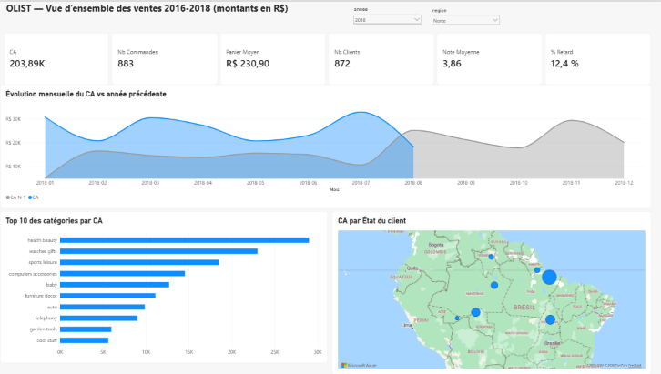
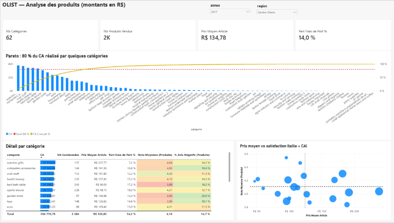
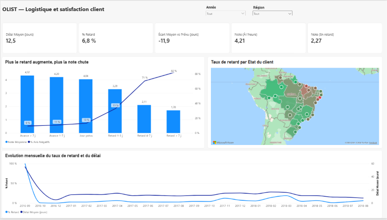
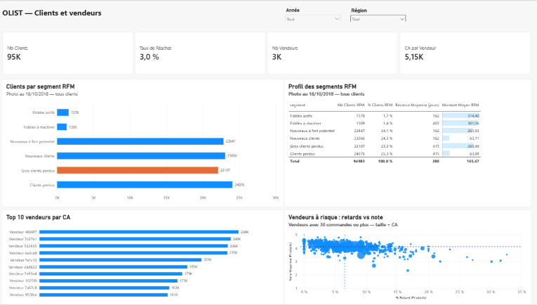

# Analyse E-commerce Olist — SQL Server → Power BI

> Projet portfolio Data Analyst : de la base de données brute au tableau de bord décisionnel.



## Contexte

**Olist** est une marketplace brésilienne qui connecte des petits vendeurs à des clients. Le jeu de données contient environ **99 000 commandes** passées entre **2016 et 2018** (montants en réais, R$).

En tant que Data Analyst, l'objectif est de construire un tableau de bord permettant à la direction de piloter les **ventes**, la **logistique** et la **satisfaction client**.

## Chiffres clés

| CA | Commandes | Panier moyen | Clients | Vendeurs | Note moyenne |
|---|---|---|---|---|---|
| **15,7 M R$** | **98 199** | **160 R$** | **~95 000** | **3 053** | **4,09 / 5** |

## Les 5 enseignements principaux

1. **Le retard détruit la satisfaction** : une commande livrée à l'heure obtient **4,29/5**, une commande en retard **2,27/5**. Au-delà de 7 jours de retard, **82 %** des avis sont négatifs.
2. **Le Nord et le Nord-Est sont pénalisés** : **12,7 %** de retards et **20 jours** de délai dans le Nordeste, contre **6,1 %** et **11 jours** dans le Sudeste, où se trouvent **60 %** des vendeurs.
3. **La fidélisation est quasi inexistante** : seuls **3 %** des clients ont commandé plus d'une fois.
4. **Une forte croissance** : CA de janvier à août 2018 **×2,4** par rapport à la même période de 2017. Le record est en **novembre 2017** (Black Friday).
5. **Le CA est concentré** : **18 catégories sur 74** font 80 % du CA, et **10 % des vendeurs** en réalisent **67 %**.

## Le dashboard (4 pages)

### 1. Vue d'ensemble
CA, commandes, panier moyen, évolution mensuelle vs année précédente, top catégories, carte du CA par État.


### 2. Produits
Analyse de Pareto, tableau détaillé par catégorie (mise en forme conditionnelle), prix moyen vs satisfaction.



### 3. Logistique et satisfaction
Délai, taux de retard, impact du retard sur la note, carte des retards par État, évolution mensuelle.



### 4. Clients et vendeurs
Segmentation RFM des clients, top 10 vendeurs, vendeurs à risque (retards vs note).



## Insights détaillés

### Ventes
- **15,7 M R$** de CA sur 2016-2018 pour **98 199 commandes**, avec un panier moyen de **160 R$**.
- Croissance forte : **8,6 M R$** de janvier à août 2018, contre **3,6 M R$** sur la même période de 2017.
- Mois record : **novembre 2017** (Black Friday), avec **1,17 M R$** et **7 421 commandes**.
- Les frais de port représentent **14 %** du CA.

### Produits
- La règle des 80/20 se vérifie : **18 catégories sur 74** (24 %) génèrent **80 %** du CA.
- Top 3 : **health beauty** (9,1 %), **watches gifts** (8,3 %), **bed bath table** (7,9 %).
- Catégories les moins bien notées (au moins 30 commandes) : **office furniture** (3,59/5, 23 % d'avis négatifs), **fashion male clothing** (3,66), **audio** (3,84). Les meubles, volumineux, reviennent souvent.
- Le **prix n'explique pas la satisfaction** : les catégories chères ne sont ni mieux ni moins bien notées.

### Logistique et satisfaction
- Délai moyen de livraison : **12,5 jours** ; **6,8 %** des commandes sont livrées en retard.
- Les délais annoncés sont très prudents : livraison en moyenne **11,9 jours avant** la date prévue.
- Note : **4,29** à l'heure contre **2,27** en retard (**-2 points**). Les commandes jamais livrées obtiennent **1,75**.
- Les avis négatifs passent de **9 %** (livraison en avance) à **82 %** (retard de plus de 7 jours).
- Régions : **Nordeste** 12,7 % de retards (20 j de délai), **Norte** 8,6 % (22,5 j), contre **Sudeste** 6,1 % (10,7 j).
- Pics de retards : **mars 2018 (19 %)**, **février 2018 (14 %)** et **novembre 2017 (12 %)**.

### Clients
- Environ **95 000 clients**, dont seulement **3 %** ont passé plus d'une commande.
- Segmentation RFM : les **fidèles** dépensent environ **310 R$** en moyenne, contre **63 R$** pour les petits clients.
- **22 107 « gros clients perdus »** : une seule commande de **265 R$** en moyenne, il y a plus d'un an.
- **48 %** des clients ont acheté dans les ~5 derniers mois : c'est le moment de déclencher leur 2e commande.

### Vendeurs
- **São Paulo** concentre **60 %** des vendeurs et **65 %** du CA, ce qui explique en partie les délais vers le Nord et le Nord-Est.
- Les **10 %** de vendeurs les plus actifs réalisent **67 %** du CA.
- Sur les **634 vendeurs** ayant au moins 30 commandes, **174** cumulent plus de retards (> 6,5 %) **et** une note plus basse (< 4,13) que la moyenne, dont **21 critiques** (au moins 15 % de retards et une note < 3,8).

## Recommandations

| Priorité | Recommandation | Pourquoi |
|---|---|---|
| 1 | **Fiabiliser la livraison** : alertes proactives au client en cas de risque de retard, suivi des transporteurs | Un retard fait perdre 2 points de note |
| 2 | **Renforcer la logistique Nord / Nord-Est** : transporteurs régionaux, recrutement de vendeurs locaux | Délais 2 fois plus longs que dans le Sudeste |
| 3 | **Anticiper les pics** (Black Friday, février-mars) : capacité transport renforcée, dates prévues ajustées | Les retards montent jusqu'à 19 % |
| 4 | **Plan d'action vendeurs** : accompagner les 174 vendeurs à risque, en commençant par les 21 critiques | Ils dégradent l'expérience client |
| 5 | **Lancer la fidélisation** : relancer les 22 107 gros clients perdus, offre de 2e commande pour les nouveaux clients | Taux de réachat de seulement 3 % |
| 6 | **Améliorer les catégories mal notées** (meubles, mode homme, audio) : fiches produits, emballage | Jusqu'à 27 % d'avis négatifs |

## Choix méthodologiques

- **Chiffre d'affaires** = prix + frais de port, hors commandes annulées (`canceled`) ou indisponibles (`unavailable`).
- **Client** = `customer_unique_id` : la source crée un nouveau `customer_id` à chaque commande.
- **Retard** = date de livraison postérieure à la date prévue, comparée **au jour près**. Les commandes non livrées sont exclues des calculs de délai et de retard.
- **Avis en double** dans la source : une note moyenne par commande.
- **Seuil de 30 commandes** pour comparer catégories et vendeurs : en dessous, les notes et taux sont trop instables.
- **2016 exclue de l'évolution mensuelle** (quelques dizaines de commandes seulement) ; **2018 est incomplète** (jusqu'en août), d'où une comparaison sur janvier-août.
- **Note par produit / vendeur** : calculée avec `TREATAS` pour passer de `fact_ventes` à `fact_commandes` sans relation entre deux tables de faits.
- **RFM** : date de référence au 18/10/2018, scores Récence et Montant en quartiles (`NTILE`). La fréquence est traitée en deux groupes (1 commande / 2 et plus) car 97 % des clients n'ont commandé qu'une fois. Les segments sont une photo fixe, non filtrée par les segments Année/Région.
- **Cartes** : géocodage par nom complet d'État (`São Paulo, Brazil`), car les codes à 2 lettres sont ambigus (PA = Panama).

## Stack technique

- **SQL Server Express** + **SSMS** : stockage, nettoyage, modélisation et segmentation RFM
- **Power BI Desktop** : modèle en étoile, mesures DAX (time intelligence, Pareto, TREATAS), visualisation
- **Git / GitHub** : versionnement et documentation

## Architecture

```
CSV Kaggle → SQL Server (schéma stg) → vues nettoyées (schéma dw) → Power BI → Dashboard
```

## Modèle de données

```
                    dim_date
                       │
    dim_client ── fact_commandes        fact_ventes ── dim_produit
                                            │
                                       dim_vendeur

    client_rfm : table autonome (segmentation RFM)
```

- **fact_commandes** : 1 ligne par commande (délais, retard, note, paiement)
- **fact_ventes** : 1 ligne par article vendu (prix, frais de port, CA)
- Relations plusieurs-à-un, filtrage dans un seul sens ; la date de livraison utilise une relation inactive activée par `USERELATIONSHIP`

## Structure du dépôt

```
olist-sql-powerbi/
├── data/raw/                     ← CSV sources (non versionnés)
├── sql/
│   ├── 01_create_database.sql    ← base OlistDB, schémas stg et dw
│   ├── 02_create_staging_tables.sql
│   ├── 03_load_data.sql          ← chargement des 9 CSV (BULK INSERT)
│   ├── 04_tests_qualite.sql      ← contrôles de qualité
│   ├── 05_create_dw_views.sql    ← schéma en étoile
│   └── 06_rfm_clients.sql        ← segmentation RFM
├── powerbi/Olist_Dashboard.pbix
├── images/                       ← captures du dashboard
└── README.md
```

## Reproduire le projet

1. Télécharger le [jeu de données Olist](https://www.kaggle.com/datasets/olistbr/brazilian-ecommerce) et placer les CSV dans `data/raw/`
2. Exécuter les scripts `sql/01` à `sql/06` dans l'ordre (SSMS, instance `localhost\SQLEXPRESS`), en adaptant le chemin `@path` dans `03_load_data.sql`
3. Ouvrir `powerbi/Olist_Dashboard.pbix` et cliquer sur **Actualiser**

## Données

Source : [Brazilian E-Commerce Public Dataset by Olist](https://www.kaggle.com/datasets/olistbr/brazilian-ecommerce) (Kaggle), sous licence CC BY-NC-SA 4.0.

## Auteur

**Merouane Ayach** — Data Analyst
